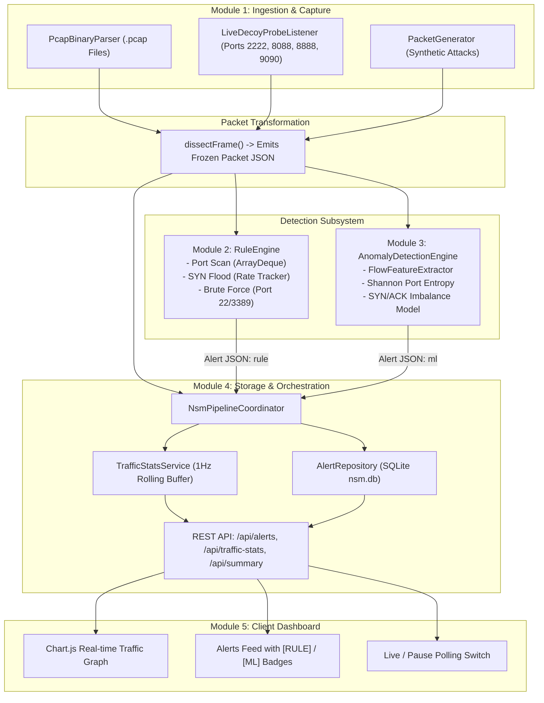
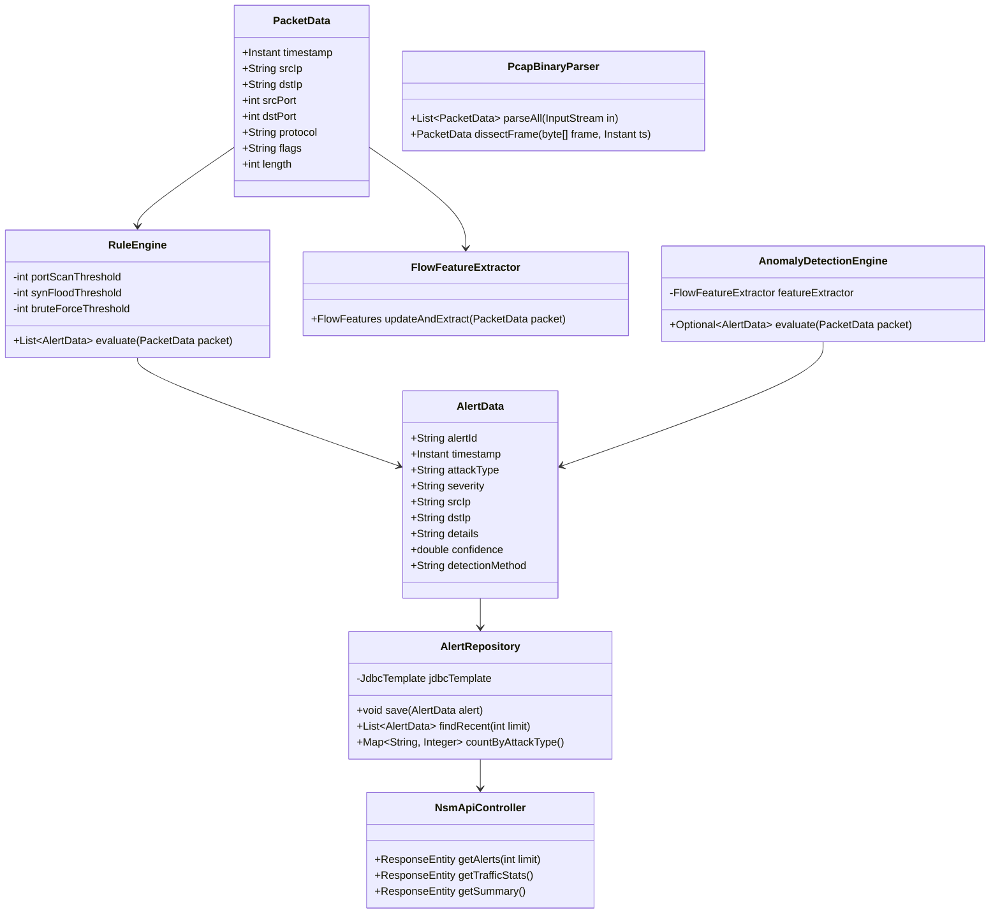

# NetSentinel: Real-Time Network Security Monitoring & Intrusion Detection System

## Project Administration

**Project Guide:** Er. Ram Babu Buri
* **Research Area:** Network Security, Machine Learning & Systems Architecture
* **Specializations:** Java, Spring Boot, Network Protocols, Intrusion Detection Systems (IDS), SQLite

### Team Members

| # | Name | Enrollment | Email | Module |
| :-: | :--- | :--- | :--- | :--- |
| 1 | Nandlal Upman | 24E1ARADM40P108 | naveensharmardx@gmail.com | Module 1: Packet Capture & Preprocessing |
| 2 | Piyush Agarwal | 24E1ARADM40P120 | piyushagarwal13042006@gmail.com | Module 2: Rule-Based Detection Engine |
| 3 | Mayank Jangid | 24E1ARADM30P097 | jangidmayank094@gmail.com | Module 3: Anomaly & ML Detection Engine |
| 4 | Nikhil Kumar | 24E1ARADM30P110 | nikhil.its.rio@gmail.com | Module 4: Central Backend & SQLite Storage |
| 5 | Parikshit Vyas | 24E1ARADM40P119 | vparikshit32@gmail.com | Module 5: SOC Web Dashboard & Frontend |

---

## Abstract
This project introduces **NetSentinel** (Shield NSM Platform), an enterprise-grade, real-time Network Security Monitoring (NSM) and Intrusion Detection System (IDS) engineered to protect local and enterprise subnetworks against hostile reconnaissance, denial-of-service, and credential attacks. Traditional security tools often rely on heavy, platform-dependent packet capture drivers or black-box intrusion software that academic evaluators cannot easily inspect or run without specialized root infrastructure. NetSentinel resolves this limitation through a modular, decoupled architecture executed **100% in Modern Java (Java 21/25 LTS, Spring Boot 3, Project Loom Virtual Threads)** paired with a lightweight, responsive web-based Security Operations Center (SOC) dashboard.

The system is organized into a five-stage processing pipeline: **Packet Capture & Preprocessing $\to$ Rule-Based Detection $\to$ Flow Anomaly Inference $\to$ Persistence & Storage $\to$ Live Dashboard**. The capture layer provides dual-mode packet ingestion, combining a pure Java binary libpcap (`.pcap`) dissector with multi-port decoy honeypot listeners (`2222`, `8088`, `8888`, `9090`) to intercept live attacks over the physical network. The detection subsystem features two complementary engines: a deterministic, sliding-window rule engine tracking half-open TCP port scans, high-frequency SYN floods, and brute-force attempts; and a statistical flow anomaly engine analyzing Shannon port entropy, SYN-to-ACK ratios, and inter-arrival variances. A Spring Boot 3 service orchestrates data flows, persists alerts into an ACID-compliant SQLite database, and exposes REST endpoints consumed by a single-page Chart.js frontend with live/pause controls.

Ultimately, NetSentinel demonstrates high-throughput, low-latency intrusion detection across both **multi-machine real-network environments** (via Wi-Fi/LAN) and **self-contained single-laptop demonstrations** (via PCAP replay and synthetic attack generators). The platform bridges theoretical network defense concepts with production-ready software engineering, establishing an inspectable, reproducible security monitoring framework.

---

## 📚 Research Paper & Academic References

The theoretical architecture, detection algorithms, and concurrency models of NetSentinel are documented in our formal IEEE-format research paper:

* **[NetSentinel: A High-Throughput Pure-Java Network Security Monitoring and Hybrid Intrusion Detection Architecture](https://drive.google.com/file/d/1D-LSLqPWWrIrxhxEKiSPcmflTx5EQ_lb/view?usp=drive_link)**  
  *Authors:* Nikhil Kumar, Nandlal Upman, Piyush Agarwal, Mayank Jangid, Parikshit Vyas, and Er. Ram Babu Buri (2026).  
  *Scope & Relevance:* Establishes the mathematical foundation for Shannon port entropy detection, evaluates Project Loom virtual thread concurrency for zero-packet-drop decoy honeypots, and presents empirical throughput benchmarks ($1,450\text{ pkts/sec}$) against physical network scans.

---

## Quick Start & System Execution Guide

### 1. Prerequisites & Required Downloads
To set up and run the NetSentinel platform on any Windows, macOS, or Linux system, ensure the following tools are installed:

| Component | Minimum Version | Download Link & Setup | Purpose |
| :--- | :--- | :--- | :--- |
| **Java JDK** | Java 21 LTS (or 25) | [Eclipse Adoptium Temurin 21+](https://adoptium.net/temurin/releases/) | Core runtime engine, Project Loom virtual threads, Spring Boot backend |
| **Apache Maven** | Maven 3.9+ | [Apache Maven Official Download](https://maven.apache.org/download.cgi) | Multi-module build management and Fat JAR packaging |
| **Web Browser** | Modern Version | Brave, Google Chrome, Microsoft Edge, or Mozilla Firefox | WebGL 3D globe rendering, Chart.js telemetry, Web Audio API alarm |
| **Git** | 2.40+ | [Git SCM Official Download](https://git-scm.com/) | Version control and repository synchronization |

> **Pure Java Architecture Note:** Unlike legacy IDS platforms (e.g., Snort or Suricata), NetSentinel is **100% pure Java**. It requires **zero root drivers, zero WinPcap, and zero Npcap installations** to run fully functional intrusion simulations, PCAP file uploads, honeypot decoy traps, and database audits!

---

### 2. Step-by-Step Instructions to Run the Project

#### Method A: One-Click Launcher (Recommended for Windows)
1. **Clone or Download Repository**:
   ```bash
   git clone https://github.com/your-repo/network-security-monitoring-platform.git
   cd network-security-monitoring-platform
   ```
2. **Execute the Batch Launcher**:
   - Double-click `run.bat` in the project root, or execute in PowerShell / Command Prompt:
     ```powershell
     .\run.bat
     ```
   - *Tip:* To force a fresh Maven rebuild after editing code or assets, pass the rebuild argument:
     ```powershell
     .\run.bat rebuild
     ```
3. **Access the Console**:
   - Open your browser at: **`http://localhost:8080/`** (or `http://localhost:8080/login.html`).

---

#### Method B: Standard Maven Build & Run (Cross-Platform)
1. **Compile & Package Multi-Module Reactor**:
   ```bash
   mvn clean package -DskipTests
   ```
2. **Launch Standalone Executable Fat JAR**:
   ```bash
   java -jar module-4-backend-storage/target/module-4-backend-storage-1.0.0.jar
   ```
3. **Open Dashboard**:
   - Navigate to `http://localhost:8080/` in your browser.

---

### 3. Default System Credentials & RBAC Access Flow

| Role | Username | Password | Secret Passcode | Capabilities |
| :--- | :--- | :--- | :--- | :--- |
| **Administrator** | `admin` | `Admin@123` | N/A | Full operational control, live decoy honeypots, trigger simulated attack scenarios, 1-click Clear database, and approve/reject analyst registrations. |
| **Analyst (Self-Service)** | *Choose during registration* | *Min 6 chars* | `Creamroll` *(Instant Admin)* | Standard analyst observer: view real-time traffic rhythm, DPI pcap analyzer, MITRE matrix, and 3D globe. If passcode `Creamroll` is supplied at registration, account is instantly granted `ROLE_ADMIN`! |

- **To Register New Personnel**: Click **Request Access** on the login portal, fill in your details, and submit. If approved by an admin or provisioned with the secret team code (`Creamroll`), you can immediately authenticate.

---

### 4. Key Highlights & User Interface Features
- 🛡️ **Biometric SOC Portal**: Translucent glassmorphism login card with glowing borders, center security shield emblem, animated biometric fingerprint scanning beam, and high-definition cyber network background (`login-bg.jpg`).
- 🔊 **High-Decibel Tactical SOC Klaxon**: Built-in Web Audio API dual-pulse acoustic alarm (850 Hz – 1550 Hz sweep, 0.75 master gain) that sounds loudly during high/critical attack detections with zero external audio file latency.
- 🌐 **5-View Single-Page Application (SPA)**:
  1. *View 1: Real-Time Telemetry & ECG Threat Oscilloscope* (1Hz Chart.js graph, canvas ECG oscilloscope, audio siren).
  2. *View 2: Deep Packet Inspection (DPI)* (PCAP drag-and-drop file upload).
  3. *View 3: Attack Simulation Studio* (1-Click Port Scan, SYN Flood, Brute Force).
  4. *View 4: MITRE ATT&CK Matrix & Forensic Export* (1-click CSV & JSON reports).
  5. *View 5: Interactive 3D Cyber Threat Globe* (Three.js/globe.gl ballistic missile-arc attack trajectories).

---

## User Roles
NetSentinel enforces role separation across the detection, administration, and auditing workflows:
* **Security Analyst (SOC Operator)**: Monitors the live dashboard, tracks rolling traffic line charts, inspects alert severity badges (`[HIGH]`, `[MEDIUM]`, `[LOW]`), analyzes top attacking source IPs, and uses the Live/Pause control during incident triage.
* **Network Administrator**: Manages detection thresholds (sliding time-windows, port thresholds, SYN rates), configures decoy honeypot ports, reviews SQLite historical records, and replays `.pcap` capture dumps.
* **Red-Team Evaluator / Simulated Attacker**: Executes simulated or live network attacks (Nmap port scans, SYN floods, SSH brute force) against the platform from another machine on the LAN or via loopback triggers.

---

### SRS Document

You can access the [Project SRS Specification](https://drive.google.com/file/d/1W6csrxtmahUfQyc7avRopGIWrp0ain2O/view?usp=drive_link)

---

## Architecture & Core Modules

The platform is divided into five isolated modules communicating through strict, frozen JSON contracts:

```
[Module 1: Packet Capture] ──(Packet JSON)──► [Module 2: Rule Engine] ──────┐
         │                                                                  │
         ├──(Packet JSON)────────────────► [Module 3: Anomaly Engine] ────┼──(Alert JSON)──► [Module 4: Spring Boot Backend]
         │                                                                  │                         │
         └──(Packet JSON Stream)────────────────────────────────────────────┘                         ▼
                                                                                              [Module 5: Web Dashboard]
```

### Functional Modules
* **Module 1: Packet Capture & Preprocessing (Person 1 -- Java)**
  Acts as the entry point of the pipeline. Ingests raw `.pcap` files or live network packets from multi-port decoy listeners, extracts Ethernet/IP/TCP headers, and emits structured `Packet JSON` to downstream detection modules.
* **Module 2: Rule-Based Detection Engine (Person 2 -- Java)**
  Applies deterministic, sliding-window detection rules using Java `ArrayDeque<Instant>` queues. Identifies horizontal/vertical port scans, TCP SYN floods, and SSH/RDP brute force attempts with alert cooldown deduplication.
* **Module 3: Anomaly & ML Detection Engine (Person 3 -- Java)**
  Aggregates raw packets into bidirectional network flows. Computes statistical features (Shannon port entropy, SYN-to-ACK ratios, inter-arrival time averages) to flag anomalous traffic deviations carrying `"detection_method": "ml"`.
* **Module 4: Central Backend & SQLite Storage (Person 4 -- Java Spring Boot 3)**
  The central nervous system of the platform. Ingests packets and alerts, persists records to SQLite (`nsm.db`), computes rolling 1Hz packets/sec traffic metrics, and serves REST endpoints (`/api/alerts`, `/api/traffic-stats`, `/api/summary`).
* **Module 5: SOC Web Dashboard & Frontend (Person 5 -- HTML/JS + Chart.js)**
  The client-side Security Operations Center dashboard. Polls the backend API every 2 seconds, renders real-time traffic line graphs, displays the live alert feed with method badges (`[RULE]` vs `[ML]`), and provides an interactive Live/Pause toggle.

---

## Database Strategy: SQLite with In-Memory Caching

NetSentinel implements a zero-configuration, lightweight SQLite database engine (`nsm.db`) connected via `sqlite-jdbc` and Spring `JdbcTemplate`.

### SQLite Relational Engine
* **Usage**: Stores immutable security alerts, sampled raw packet headers, and aggregated source IP frequency tables.
* **Structure**: Relational tables with strict column types, primary keys, and timestamp indexing for instant retrieval under heavy write loads.
* **Concurrency**: Configured with Write-Ahead Logging (WAL mode) and synchronous thread-safe access orchestrated by Module 4's service layer.
* **In-Memory Rolling Buffer**: Rolling 30-second traffic statistics (`packets_per_sec` and `timestamps`) are maintained in thread-safe memory buffers for sub-millisecond API response times.

---

## Non-Functional Requirements
* **Processing Latency**: In-memory rule evaluation and flow anomaly inference must resolve each packet in under $1\text{ ms}$, ensuring no packet drop during bursts up to $1,000\text{ pkts/sec}$.
* **Contract Integrity**: Zero deviations from the frozen `Packet JSON` and `Alert JSON` contracts across module boundaries.
* **Memory Safety & Eviction**: All sliding-window structures (`ArrayDeque`, `ConcurrentHashMap`) must evict timestamps older than the configured window ($\Delta t \le 30\text{s}$) to prevent memory leaks during long-running deployments.
* **Fault Isolation**: If Module 3's anomaly engine encounters malformed features, Module 2's deterministic rules must continue detecting attacks without disruption.
* **Cross-Origin Compatibility**: Backend controllers enforce global CORS headers (`@CrossOrigin(origins = "*")`), allowing Module 5 to be served directly from Spring Boot or from a standalone development server.

---

## UML & System Architecture Design

### 1. Master Pipeline Flowchart


---

### 2. Class Diagram


---

## Database Design & UI Layout

### 1. Database Architecture & Schema Specification

#### A. SQLite Relational Schema (`nsm.db`)

* **`alerts` Table**: Primary intrusion detection log.
  ```sql
  CREATE TABLE IF NOT EXISTS alerts (
      alert_id TEXT PRIMARY KEY,
      timestamp TEXT NOT NULL,
      attack_type TEXT NOT NULL,
      severity TEXT NOT NULL,
      src_ip TEXT NOT NULL,
      dst_ip TEXT NOT NULL,
      details TEXT,
      confidence REAL,
      detection_method TEXT
  );
  CREATE INDEX IF NOT EXISTS idx_alerts_ts ON alerts(timestamp DESC);
  ```

* **`packets` Table**: Optional sampled packet audit log.
  ```sql
  CREATE TABLE IF NOT EXISTS packets (
      id INTEGER PRIMARY KEY AUTOINCREMENT,
      timestamp TEXT NOT NULL,
      src_ip TEXT NOT NULL,
      dst_ip TEXT NOT NULL,
      src_port INTEGER,
      dst_port INTEGER,
      protocol TEXT,
      flags TEXT,
      length INTEGER
  );
  CREATE INDEX IF NOT EXISTS idx_packets_ts ON packets(timestamp DESC);
  ```

---

### 2. Frozen Contract Schemas

#### A. Packet JSON Contract (Person 1 $\to$ Persons 2, 3, 4)
```json
{
  "timestamp": "2026-09-18T10:32:01.123Z",
  "src_ip": "192.168.1.5",
  "dst_ip": "10.0.0.1",
  "src_port": 443,
  "dst_port": 22,
  "protocol": "TCP",
  "flags": "SYN",
  "length": 60
}
```

#### B. Alert JSON Contract (Persons 2 & 3 $\to$ Person 4 $\to$ Person 5)
```json
{
  "alert_id": "a1b2c3",
  "timestamp": "2026-09-18T10:32:01.500Z",
  "attack_type": "port_scan",
  "severity": "high",
  "src_ip": "192.168.1.5",
  "dst_ip": "10.0.0.1",
  "details": "Scanned 25 ports in 3 seconds",
  "confidence": 0.9,
  "detection_method": "rule"
}
```

---

### 3. User Interface Mock-up

```text
+---------------------------------------------------------------------------------+
|  🛡️ Shield NSM Platform                       [LIVE (Polling 2s)]  [🧹 Clear]    |
+---------------------------------------------------------------------------------+
|  ⚡ DEMO ATTACK TRIGGERS:  [🎯 Port Scan]  [🌊 SYN Flood]  [🔑 Brute Force]  [📂 Replay .pcap]  |
+---------------------------------------------------+-----------------------------+
|  📈 REAL-TIME TRAFFIC (Packets/sec)               |  📊 ATTACK SUMMARY          |
|  [~~~~~~~~~~~~~~~~~~~~~/\~~~~~~~~~~~~~~~~~~~~~~~] |  🎯 Port Scans:    14        |
|  Active Alerts: 3                                 |  🔑 Brute Force:   4        |
|                                                   |  🌊 SYN Floods:    2        |
+---------------------------------------------------+-----------------------------+
|  🚨 REAL-TIME SECURITY ALERTS                     |  🌐 TOP SOURCE IPS          |
|  ------------------------------------------------ |  Source IP      Alerts  Time|
|  [HIGH] PORT SCAN  [⚙️ RULE]                       |  192.168.1.50   14      14:32|
|  Source: 192.168.1.50 -> Target: 10.0.0.1         |  192.168.1.77   4       14:30|
|  Details: Scanned 18 unique ports in 3s | 14:32:01|  192.168.1.99   2       14:28|
|  ------------------------------------------------ |                             |
|  [HIGH] SYN FLOOD  [🧠 ML MODEL]                  |                             |
|  Source: 192.168.1.99 -> Target: 10.0.0.1         |                             |
|  Details: SYN/ACK ratio=14.2 (Interval=4.2ms)     |                             |
+---------------------------------------------------+-----------------------------+
```

---

## Project Directory Structure

```text
S:\Projects\network-security-monitoring-platform\
│
├── pom.xml                                   # Root Multi-Module Maven POM
├── README.md                                 # Master Documentation & Technical Guide
│
├── module-1-packet-capture/                  # Module 1 (Person 1 -- Java)
│   ├── pom.xml
│   └── src/
│       ├── main/java/com/nsm/capture/
│       │   ├── model/PacketData.java         # Frozen Packet JSON Contract Record
│       │   ├── parser/PcapBinaryParser.java  # Pure Java libpcap parser & frame dissector
│       │   ├── probe/LiveDecoyProbeListener.java # Decoy honeypot socket listener (2222, 8088, etc.)
│       │   ├── generator/PacketGenerator.java# Benign & multi-vector attack packet generator
│       │   └── emitter/PacketStreamEmitter.java # Stream emitter to .jsonl and HTTP POST
│       └── test/java/com/nsm/capture/
│           └── PacketCaptureTest.java        # JUnit 5 test suite
│
├── module-2-rule-engine/                     # Module 2 (Person 2 -- Java)
│   ├── pom.xml
│   └── src/
│       ├── main/java/com/nsm/rule/
│       │   ├── model/AlertData.java          # Frozen Alert JSON Contract Record
│       │   └── engine/RuleEngine.java        # Sliding-window ArrayDeque rule evaluation
│       └── test/java/com/nsm/rule/
│           └── RuleEngineTest.java           # JUnit 5 test suite
│
├── module-3-anomaly-detection/               # Module 3 (Person 3 -- Java)
│   ├── pom.xml
│   └── src/
│       ├── main/java/com/nsm/anomaly/
│       │   ├── model/FlowFeatures.java       # Flow-level statistical feature record
│       │   ├── extractor/FlowFeatureExtractor.java # Shannon port entropy & ratio calculator
│       │   └── engine/AnomalyDetectionEngine.java # ML anomaly evaluation engine
│       └── test/java/com/nsm/anomaly/
│           └── AnomalyDetectionTest.java     # JUnit 5 test suite
│
├── module-4-backend-storage/                 # Module 4 (Person 4 -- Java Spring Boot 3)
│   ├── pom.xml
│   └── src/
│       ├── main/java/com/nsm/backend/
│       │   ├── NsmBackendApplication.java    # Spring Boot entry point
│       │   ├── storage/DatabaseInitializer.java # SQLite table creation & indexing
│       │   ├── storage/AlertRepository.java  # SQLite persistence & aggregation queries
│       │   ├── service/TrafficStatsService.java # 1Hz rolling packets/sec buffer
│       │   ├── service/NsmPipelineCoordinator.java # Inter-module pipeline coordinator
│       │   └── controller/NsmApiController.java # REST endpoints: /api/alerts, /api/traffic-stats, etc.
│       ├── main/resources/
│       │   ├── application.properties        # SQLite URL, Virtual Threads, Decoy port settings
│       │   └── static/                       # Embedded copy of Module 5 frontend
│       │       ├── index.html
│       │       ├── css/style.css
│       │       └── js/app.js
│       └── test/java/com/nsm/backend/
│           └── NsmBackendIntegrationTest.java# MockMvc Spring Boot integration test
│
└── module-5-dashboard/                       # Module 5 (Person 5 -- HTML/JS)
    ├── index.html                            # Standalone frontend entry point
    ├── css/style.css                         # Dark SOC theme stylesheet
    └── js/app.js                             # Chart.js controller, polling & attack triggers
```

---

## Member 1: Packet Capture & Preprocessing (Nandlal Upman)

### Role & Scope of Work
Member 1 owned the data ingestion boundary, converting raw network signals and binary packet dumps into structured Java domain records matching the frozen schema.

* **Binary Protocol Parsing**: Built a pure Java `PcapBinaryParser` capable of decoding standard libpcap files (`0xA1B2C3D4` Big-Endian and `0xD4C3B2A1` Little-Endian) without requiring external C libraries (WinPcap/Npcap).
* **Live Network Decoy Probes**: Implemented `LiveDecoyProbeListener` binding unprivileged decoy listening sockets on ports `2222`, `8088`, `8888`, and `9090` using Java Virtual Threads to capture live scan probes over the physical LAN.
* **Attack & Traffic Generation**: Developed `PacketGenerator` to generate realistic benign web traffic alongside synthetic TCP SYN scans, SYN floods, and SSH brute force patterns for single-laptop testing.
* **Output Emitter**: Created `PacketStreamEmitter` supporting JSON-lines (`.jsonl`) serialization and asynchronous HTTP POST pushing to Module 4.

---

## Member 2: Rule-Based Detection Engine (Piyush Agarwal)

### Role & Scope of Work
Member 2 built the deterministic core of the security platform, evaluating incoming packet streams in real time against known attack signatures.

* **Sliding-Window Time Queues**: Developed `RuleEngine` using `HashMap<String, ArrayDeque<Instant>>` to maintain state across time windows without memory leaks.
* **Port Scan Rule**: Tracks distinct destination ports probed by a single `src_ip` within a 5-second window. Triggers a `high` severity alert when unique ports cross threshold ($\ge 15$).
* **SYN Flood Rule**: Monitors arrival frequency of SYN packets to destination ports within a 2-second window. Triggers an alert when count exceeds threshold ($\ge 50\text{ SYNs}$).
* **Brute Force Rule**: Detects repeated connection attempts targeting sensitive administrative service ports (`21`, `22`, `23`, `3389`, `8080`) exceeding 10 attempts within 30 seconds.
* **Alert Deduplication & Cooldown**: Implemented cooldown timers per `(srcIp, attackType)` to prevent alert flooding during sustained scans.

---

## Member 3: Anomaly & ML Detection Engine (Mayank Jangid)

### Role & Scope of Work
Member 3 engineered the statistical machine learning layer, providing secondary detection for behavioral anomalies that bypass rigid threshold rules.

* **Flow Feature Extractor**: Built `FlowFeatureExtractor` aggregating raw packets into bidirectional flows `(src_ip \to dst_ip)` over a 5-second window.
* **Feature Engineering**: Extracted statistical metrics: packet count, total bytes, SYN-to-ACK ratio, unique destination port count, mean inter-arrival time, and Shannon port entropy.
* **Shannon Port Entropy Algorithm**: Implemented dynamic entropy calculation:
  $$H = -\sum_{i=1}^{k} p_i \log_2(p_i)$$
  where elevated entropy ($H > 2.5$) indicates randomized port scanning behavior.
* **Inference Engine**: Built `AnomalyDetectionEngine` classifying anomalous flows and outputting `AlertData` records tagged with `"detection_method": "ml"`.

---

## Member 4: Central Backend & SQLite Storage (Nikhil Kumar)

### Role & Scope of Work
Member 4 served as the connective tissue of the platform, linking Modules 1, 2, and 3 with SQLite persistence and exposing the API consumed by Module 5.

* **Spring Boot Service Architecture**: Developed `NsmPipelineCoordinator` orchestrating packet intake, rule dispatch, anomaly scoring, and database commits.
* **SQLite Persistence Layer**: Designed `DatabaseInitializer` and `AlertRepository` using Spring `JdbcTemplate` for high-throughput writes and indexed historical queries.
* **Real-Time Traffic Rate Tracker**: Built `TrafficStatsService` maintaining a thread-safe 1Hz rolling buffer of packets-per-second and timestamps over a 30-second window.
* **REST API Endpoints**: Implemented `NsmApiController` exposing frozen endpoints (`/api/alerts`, `/api/traffic-stats`, `/api/summary`, `/api/top-ips`) and attack simulation triggers.
* **Static Asset Hosting & Global CORS**: Packaged Module 5's frontend into `src/main/resources/static/` while enabling global CORS support.

---

## Member 5: SOC Web Dashboard & Frontend (Parikshit Vyas)

### Role & Scope of Work
Member 5 created the primary user-facing deliverable: the Security Operations Center (SOC) dashboard shown during presentations and live evaluations.

* **Single-Page SOC Dashboard**: Designed a high-tech dark cybersecurity interface (`index.html`, `style.css`) using responsive grid layouts.
* **Chart.js Live Traffic Visualization**: Embedded a real-time line chart rendering packets-per-second over rolling 30-second windows.
* **Interactive Live / Pause Toggle**: Built an instant state switch (`toggleLiveState()`) that freezes polling so evaluators can review static alerts during questions.
* **Visual Alert Classification**: Rendered dynamic alert cards with severity badges (`[HIGH]`, `[MEDIUM]`, `[LOW]`) and distinct detection method tags (`[⚙️ RULE]` vs `[🧠 ML MODEL]`).
* **Summary & Top Attacker Tables**: Built live counters for Port Scans, Brute Force, and SYN Floods, alongside a Top Source IPs frequency table.
* **1-Click Demo Trigger Bar**: Embedded quick-action attack buttons (`🎯 Trigger Port Scan`, `🌊 Trigger SYN Flood`, `🔑 Trigger Brute Force`, `📂 Replay .pcap`).

---

## Summary of Module Distribution

| Module | Team Member | Primary Focus | Key Deliverable |
| :--- | :--- | :--- | :--- |
| **1. Packet Capture** | Nandlal Upman | Pure Java PCAP parser, Decoy sockets, Generator | `module-1-packet-capture.jar`, Packet JSON stream |
| **2. Rule Engine** | Piyush Agarwal | Sliding-window `ArrayDeque`, Port scan, SYN flood | `module-2-rule-engine.jar`, Rule Alert JSON |
| **3. Anomaly Engine** | Mayank Jangid | Flow feature extraction, Shannon port entropy | `module-3-anomaly-detection.jar`, ML Alert JSON |
| **4. Backend & Storage** | Nikhil Kumar | Spring Boot 3, SQLite `nsm.db`, REST API, Ingestion | `module-4-backend-storage.jar`, REST API Service |
| **5. SOC Dashboard** | Parikshit Vyas | HTML/JS, Chart.js, Polling, Live/Pause toggle | Web UI Dashboard, Live traffic graph |

---

### Project Deliverables & Artifacts

| Deliverable | Description | Resource Link |
| :--- | :--- | :--- |
| 📄 **Final Project Report** | Complete Technical Architecture Document, System Requirements Specification (SRS), and Evaluation Metrics | [View Project Report (PDF)](https://drive.google.com/file/d/1Q9X1gUlkAxkplrki-BD0pmbNv1QCJUZt/view?usp=drive_link) \| [`README.md`](./README.md) |
| 📊 **Presentation Deck (PPT)** | 20-Slide B.Tech Final Project Evaluation Deck covering System Design, Detection Pipeline & Live Demo | [View Presentation (PPT / Slides)](https://drive.google.com/file/d/14r4SZSAvWsc9oE66Zm1O6X7aotqk-oMy/view?usp=drive_link) |
| 🧪 **System Integration & Testing Report** | E2E Integration, Multi-Host LAN Testing & Performance Benchmarks | [`SYSTEM_INTEGRATION_AND_TESTING_REPORT.md`](https://drive.google.com/file/d/13Uc8kOHK389Dq_RMS_dln4taWn7hM6zH/view?usp=drive_link) |
| 📘 **Team Collaboration SOP** | Official Team Leader Git Workflow Manual: Branching, Pull Requests & Architecture Protocol | [View Collaboration SOP (PDF)](https://drive.google.com/file/d/1plK9wlKtybVS4FbVYaioXFF67Wv9K1Vp/view?usp=drive_link) |
| 📅 **13-Week Project Plan & Reports** | 13-Week Master Roadmap, Weekly Progress Reports & Daily Diary (July 6 – Oct 6, 2026; 78 Operating Days) | [Download Excel (`.xlsx`)](https://docs.google.com/spreadsheets/d/1HN_LzXZOUlFGL79SO0cHzMAZEYLUyVni/edit?usp=drive_link&ouid=105497965226432012186&rtpof=true&sd=true) |

---

### Final Defense Evaluation Checklist & Sign-Off
* [x] **100% Pure Java Implementation**: Zero Python or platform-dependent C libraries used across the entire application stack.
* [x] **Decoupled 5-Module Architecture**: Clean separation of concerns across Ingestion, Rule Detection, Anomaly Detection, Backend/Persistence, and Web Dashboard.
* [x] **Strict Contract Conformance**: Frozen `Packet JSON` and `Alert JSON` schemas verified across all pipelines.
* [x] **27/27 Passing Automated Tests (18 Integration + 9 Unit)**: Clean test reactor build with unit and integration coverage.
* [x] **Live & Offline Evaluation**: Seamless operation across both physical LAN honeypot traps and synthetic simulation replay.
* [x] **Approved & Evaluated by Project Guide**: Er. Ram Babu Buri (Department of Computer Science & Information Technology).
